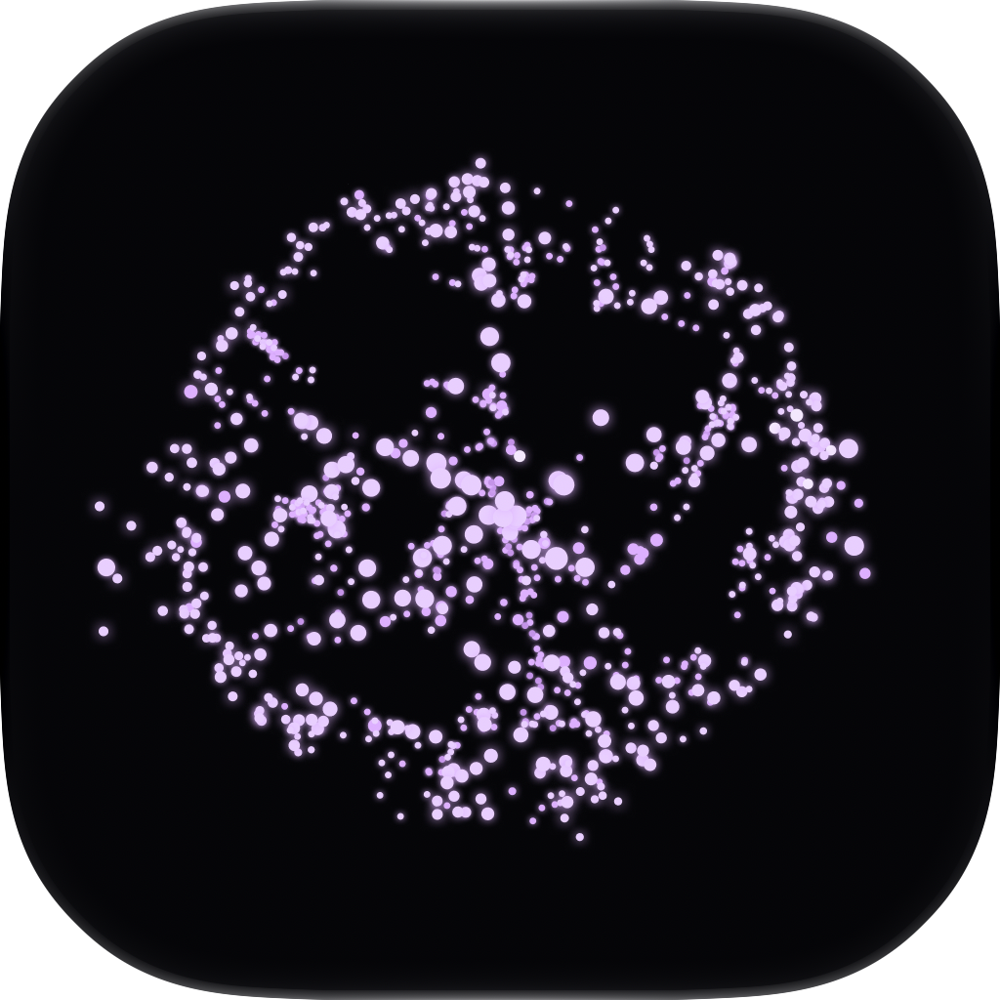

  
  <h1>Lyrian — Support, Privacy & Terms</h1>
  
<strong>Transforming sound into a multisensory voyage of light, motion, and touch.</strong>

  
<em>Official support center, terms of use, privacy policy, and open-source licenses for the Lyrian application.</em>

---

## 🌟 About Lyrian

**Lyrian** is an immersive music player for **iPhone** and **Apple Watch** designed to transform the listening experience into a rich, multisensory journey.

Powered by state-of-the-art deep learning neural models executed **100% locally on-device (via CoreML)**, the app deconstructs tracks into isolated audio stems (**vocals, drums, bass, other**). It dynamically translates frequencies and rhythms into **synchronized tactile haptic vibrations** and **real-time audio-reactive visualizers**, making music deeply accessible and tactile.

---

## 📂 Repository Structure

This repository hosts the official static web pages (ready for **GitHub Pages** deployment) that fulfill the compliance and legal requirements for the Apple App Store, Google Play Store, and privacy regulations (such as GDPR and Brazil's LGPD):

| Page | File | Description |
|---|---|---|
| **Support & FAQ** | [`index.html`](index.html) | Central user support hub, app overview, frequently asked questions, and direct support contact (`lyrianapp@gmail.com`). |
| **Privacy Policy** | [`privacy.html`](privacy.html) | Transparent privacy disclosures, strictly on-device AI processing details, Apple service integrations (ShazamKit, CloudKit, Apple Music, WatchConnectivity), and data subject rights. |
| **Terms of Use** | [`terms.html`](terms.html) | Terms of service, software license, user copyright responsibility for imported music, AI separation limitations, and sensory sensitivity/safety disclaimers. |
| **Open Source & Licenses** | [`licenses.html`](licenses.html) | Full compliance with the **MIT License** terms for the **HTDemucs** and **SCNet** neural models, alongside acknowledgments for royalty-free demo tracks (CC0 / Public Domain). |

---

## 🔒 Privacy & Architecture Principles

1. **100% On-Device AI Processing:** All neural network inference for **HTDemucs** and **SCNet** runs directly on the device hardware. User audio files and personal recordings are never transmitted to external cloud servers for processing, nor used to train third-party models.
2. **ShazamKit Music Recognition:** Music identification queries rely strictly on mathematical acoustic signatures (hashes). Raw audio recordings are never sent to Apple.
3. **CloudKit Public Catalog:** Audio tracks provided in the in-app public library are downloaded unidirectionally to a local device cache. Personal recordings and imported files are never uploaded to CloudKit.
4. **Zero Tracking or Advertising:** Lyrian contains no third-party tracking scripts, no behavioral analytics SDKs, and does not sell or share data with data brokers.

---

## 🚀 GitHub Pages Deployment

The live website is available at `https://<your-username>.github.io/Lyrian---Support/`.

---

## 📬 Contact & Support

For technical assistance, feedback, or legal inquiries:
- **Email:** [lyrianapp@gmail.com](mailto:lyrianapp@gmail.com)

---

  &copy; 2026 Lyrian. All rights reserved.

